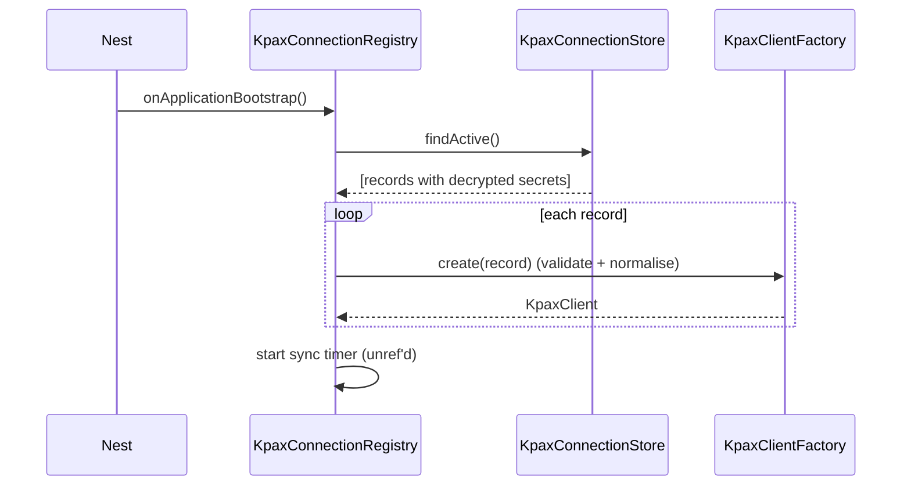
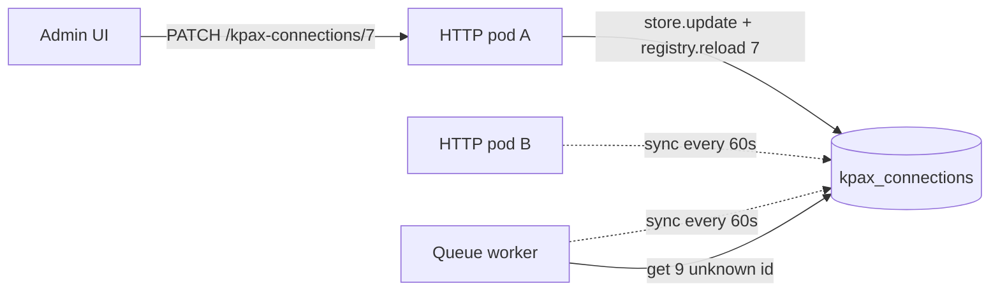

# Architecture

## Components

```
KpaxModule
├── KpaxConnectionRegistry   one KpaxClient per active stored connection (inject this)
├── KpaxClientFactory        builds clients; ad-hoc connections; testConnection()
├── KpaxTokenService         OAuth2 client-credentials tokens, cached per connection
├── KPAX_CONNECTION_STORE    your KpaxConnectionStore (e.g. KnexKpaxConnectionStore subclass)
└── HttpModule               axios via @nestjs/axios
```

| Piece | Responsibility | Lifetime |
|---|---|---|
| `KpaxConnectionStore` (yours) | Read connections from the DB, decrypt secrets. Optionally write them. | Singleton |
| `KpaxConnectionRegistry` | Load active connections at boot, keep them in sync, hand out clients by id | Singleton |
| `KpaxClient` | Talk to **one** KPAX instance: auth header, retries, rate limits, typed endpoints | One per connection fingerprint |
| `KpaxTokenService` | Fetch/cache/refresh tokens keyed by connection fingerprint | Singleton |
| `KpaxClientFactory` | Create clients, cache ad-hoc ones, run connection tests | Singleton |

The library never touches your database directly: everything goes through the store
interface, so it doesn't care whether connections come from knex, TypeORM, Prisma or a
secrets manager.

## Boot sequence



- No KPAX traffic happens at boot. Tokens are fetched lazily on a client's first request.
- A row that fails validation (bad URL, undecryptable secret) is skipped and logged; the
  rest still load.
- If the store itself fails (DB down, table not migrated yet) the app still starts, logs
  the error and retries on the next sync — unless `registry.failOnBootError` is set.

## Runtime changes and multiple processes

A typical deployment runs several processes that each boot the module: HTTP replicas,
queue workers, schedulers. Each holds its own registry in memory, so a change made through
the admin API in one process has to reach the others.



| Event | Process that handled the admin write | Other processes |
|---|---|---|
| Connection created | `registry.reload(id)` → live immediately | Live on **first use** (`loadOnMiss`) or next sync |
| Secret / host / scopes changed | `registry.reload(id)` → new client + token immediately | Next sync (≤ `syncIntervalMs`) |
| Name changed only | Warm client kept, summary updated | Next sync |
| Deactivated / deleted | `registry.remove(id)` → gone immediately | Next sync |

Change detection relies on `updatedAt`: the store must bump it on every write
(`KnexKpaxConnectionStore` does, and guarantees it moves forward even within the same
millisecond). When the store implements `findActiveVersions()`, a sync reads only
`id, updated_at` for all rows and re-reads just the rows that changed.

Need sub-second propagation? Publish an event after admin writes (NATS, Redis pub/sub) and
call `registry.reload(id)` in the subscriber — see
[connection-registry.md](connection-registry.md#instant-propagation-optional). Periodic
sync remains the safety net.

## Connection identity and tokens

Each client is bound to an immutable connection. Its **fingerprint** is
`sha256(host, clientId, clientSecret, sorted scopes)` — the secret is hashed, never held
in a map key or log line.

- Tokens are cached per fingerprint. Two ids pointing at the same credentials share one token.
- Changing host, client id, secret or scopes changes the fingerprint → new client, new token.
  The old token is released as soon as no connection uses it.
- Changing only metadata (name) keeps the existing client and its warm token.
- Tokens refresh `tokenRefreshSkewSeconds` before expiry; concurrent callers share one
  in-flight token request.
- A 401 from the API forces one token refresh and one retry (covers revoked tokens).

## Request pipeline

```
client.getDevice(42)
  → wait if this connection is rate-limit-blocked
  → token (cached / refreshed)
  → GET {host}/api/v1/devices/42   (timeout per attempt)
  → 401? refresh token once, retry
  → 429? wait Retry-After / X-RateLimit-Reset, retry (all methods)
  → 5xx / network? exponential backoff + jitter, retry (GET/PUT/DELETE only)
  → non-2xx → KpaxApiError; 2xx → typed body
```

Rate-limit state (`X-RateLimit-Remaining: 0` → hold until `X-RateLimit-Reset`) is tracked
per client, i.e. per KPAX connection. It is also per process: several processes using the
same credentials each see KPAX's headers independently.

## Security notes

- Secrets reach the library already decrypted by your store and are kept only in memory.
- `list()`, `entriesList()` and `KpaxConnectionView` never include secrets.
- Error messages include KPAX's response message, never request headers or credentials.
- Clients are frozen (`connection` is read-only) so code can't mutate credentials in place.
- Store secrets encrypted at rest. The example uses AES-256-GCM
  ([`SecretCipher`](../examples/nestjs-admin/secret-cipher.ts), key from `KPAX_SECRET_KEY`).
